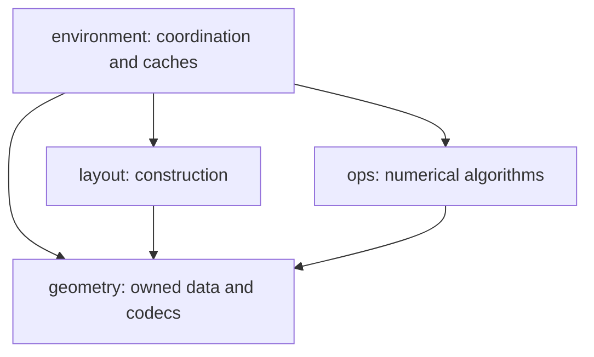

# Architecture & Internals

This page covers the internals you need when **extending** neurospatial —
writing a custom layout engine, or reading the raw graph metadata directly.
Most users never need this; the mental model in
[Core Concepts](../getting-started/core-concepts.md) is enough for day-to-day
analysis.

## Mandatory Graph Metadata

Every environment carries a **connectivity graph** (a NetworkX `Graph`) whose
nodes are bins and whose edges connect neighboring bins. neurospatial enforces
a set of **mandatory attributes** on that graph so that spatial queries
(shortest paths, geodesic distances, neighbor finding) are always well-defined.

**Node attributes:**

- `'pos'`: Tuple of N-D coordinates (the bin center)
- `'source_grid_flat_index'`: Flat index in the original grid
- `'original_grid_nd_index'`: N-D grid index tuple

**Edge attributes:**

- `'distance'`: Positive navigation path length; native grids use the distance
  between centers, while explicit bins can declare longer paths
- `'vector'`: Displacement vector (as a tuple)
- `'edge_id'`: Unique integer edge identifier
- `'angle_2d'`: Angle in 2D (optional, present for 2D layouts)

You can read these attributes directly off `env.connectivity`:

```python
import numpy as np
from neurospatial import Environment

positions = np.random.default_rng(0).uniform(0, 50, size=(500, 2))
env = Environment.from_samples(positions, bin_size=5.0, units="cm")

G = env.connectivity
print(f"Number of nodes: {G.number_of_nodes()}")
print(f"Number of edges: {G.number_of_edges()}")

# Node attributes (mandatory)
node_0_attrs = G.nodes[0]
print(f"Node 0 position: {node_0_attrs['pos']}")
print(f"Node 0 grid index: {node_0_attrs['original_grid_nd_index']}")

# Edge attributes (mandatory) — pick any existing edge
u, v = next(iter(G.edges))
edge_attrs = G.edges[u, v]
print(f"Edge ({u},{v}) distance: {edge_attrs['distance']}")
print(f"Edge ({u},{v}) vector: {edge_attrs['vector']}")
```

These attributes enable geodesic distances and shortest-path queries. Diffusion
uses the owned cell faces and volumes in `env.binning`, rather than treating
every navigation edge as a physical interface. A navigation connection can carry
a path without permitting diffusion across it.

## Package responsibilities

The arrows show permitted dependencies between these packages:



`geometry/` holds immutable bins, locators, arena evidence, coordinate semantics,
validation and codecs. It does not import builders, numerical solvers, storage
backends or plotting libraries. `layout/` and `ops/` are independent peers.
Import-linter checks these package boundaries without exceptions.

An environment captures construction output once, owns its geometry, and starts
fresh caches when derived or restored. Public methods delegate to domain
functions with the components they read (bins, graph, arena, coordinate
descriptor and the analysis cache), and those functions do not call back into
the environment. Numerical builders take explicit data and arrays; callers use
public operations for cached analyses. Packages that consume an environment,
such as `ops`, declare small consumer protocols of the operations they need.

## Custom construction

Use `Environment.from_bins(...)` for explicit Cartesian `Binning` records, or
`Environment.from_layout(...)` for supported layout construction. Every layout
engine, built-in or custom, hands its geometry to the environment through
`binning()`, which returns a `Binning` built from the engine's own state: bins in
connectivity edge order, point lookup, lazily computed faces and any grid,
track, shape or outline records. The environment keeps that record, not the
engine, so live lookup or track-conversion callbacks do not remain attached.
External objects without `binning()` use registered adapters to supported
built-in snapshots.

Centers and a graph alone establish neither exact cell ownership nor diffusion
faces. Supply a supported locator and explicit `KnownFaces` or `MissingFaces`;
optional grid, track and drawing components establish their own capabilities.
See [geometry access and cache ownership](../migration/environment-geometry.md)
for snapshot reuse and the numerical API.

See the [layout engines guide](../user-guide/layout-engines.md) for the
built-in engines and their factory methods.
