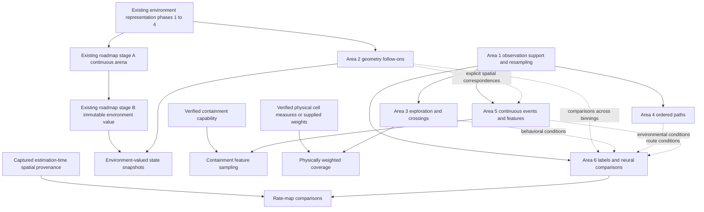

# Continuous behavior and neural analysis implementation plan

**Created**: 2026-10-14
**Committed**: 2026-10-14
**Status**: Accepted scope; implementation not started

Enable scientists to analyze continuous exploration, repeated routes, experience,
and changing experimental conditions, then connect those measurements to neural
representations. The implementation should work across conventional mazes,
free-foraging arenas, and experiments with changing barriers or rewards.

The six workstreams below record the agreed scope. Their implementation order
follows dependencies rather than their numbering. New public names in phase
files are proposals; check them against existing names and the public API
contract before exporting them.

## Scope and design rules

1. Preserve observation support, source sample identity, timestamps, coordinate
   frames, units, and spatial correspondence as operations compose.
2. Keep module functions and raw-array inputs first-class. Optional immutable
   results carry derived arrays, support, and settings; a global experiment,
   session, or trajectory container is not a prerequisite.
3. Distinguish environment geometry, feasible movement, empirical behavior,
   spatial features, and inferred knowledge. Learned routes and unknown sensory
   cues do not redefine the physical arena.
4. Extend existing intervals, visits, estimators, result conventions, and
   adapters before introducing parallel implementations.
5. Evaluate complete workflows and scientific invariants. Explain units,
   eligible space, missing observations, and sufficient support in results.
6. Prefer methods useful across experiments. Path-bundle analysis is one
   ordered-path comparison method; hexagonal terrain is one feature example.

New behavioral null models, grouped bootstraps, and a general statistical
framework are outside this accepted scope. Existing statistics may be used in
examples; these phases do not implement that seventh proposed workstream.
Pose reconstruction, camera calibration, navigation agents, Sparsemap
optimization, automatic latent route clustering, and arbitrary joint GLM
frameworks also remain separate proposals.

## Reading order

- Start with the relevant phase file and [shared contracts](shared-contracts.md).
- Use [TASKS.md](TASKS.md) to track milestones and cross-phase integration.
- Read [design principles](../../contributing.md#design-principles) and the
  [public API contract](../../../.claude/rules/public-api.md) before choosing
  public signatures and result exports.
- For geometry work, read the
  [environment representation plan](../environment-representation/PLAN.md).
  Its phases 1–4 and shared contracts remain authoritative for that refactor.

## Workstreams

| Area | Plan | Deliverable | Prerequisites |
| --- | --- | --- | --- |
| 1. Observation support | [phase-1-observation-support.md](phase-1-observation-support.md) | Consistent validity and explicit breaks, cumulative distance, distance resampling, movement units and provenance | Existing interval and trajectory machinery |
| 2. Environment contracts | [phase-2-environment-contracts.md](phase-2-environment-contracts.md) | Durable geometry, bin identity/correspondence, measures and movement/face semantics | Existing representation phases 1–4 for stored-geometry follow-ons; individual slices specify later arena prerequisites |
| 3. Exploration and crossings | [phase-3-exploration-and-crossings.md](phase-3-exploration-and-crossings.md) | Occurrence-preserving crossings, coverage/discovery, first arrivals, revisits, causal history | Area 1; eligible spatial support; verified measures or supplied weights for physical coverage |
| 4. Ordered paths | [phase-4-path-analysis.md](phase-4-path-analysis.md) | Sparse matches with local direction compatibility, repertoire comparisons, preceding/following segments | Area 1; area 3 records are optional cohort inputs |
| 5. Events and features | [phase-5-event-alignment-and-features.md](phase-5-event-alignment-and-features.md) | Typed continuous-event interpolation/reduction; static, egocentric, and state-selected feature sampling | Area 1; verified containment for that mode; area 2 correspondence where needed; stage B for environment snapshots |
| 6. Neural comparisons | [phase-6-neural-comparisons.md](phase-6-neural-comparisons.md) | Labels to epochs, conditioned encoding/decoding, one-to-one common-support comparisons | Area 1 plus estimation-time spatial provenance before comparisons; area 2 for differing binnings; areas 3–5 supply richer conditions |

## Dependency and delivery order

Solid arrows are prerequisites. Dotted arrows enable additional workflows and
do not block initial array-based implementation. Distance resampling, continuous
event alignment, and comparisons on one environment do not wait for the entire
continuous-arena roadmap.
Capability gates apply only to the corresponding slices: count-based coverage,
label conversion, continuous signal alignment, and explicit nearest-bin sampling
remain independently deliverable. Physical weighting cannot use approximate
subset sizes, and environment snapshots wait for actual immutable-value support.
Same-binning neural comparisons need captured source context even when they do
not need new bin-correspondence machinery.

| Milestone | Reviewable outcome |
| --- | --- |
| M0. Contracts and baseline | Confirm API/result semantics, capture current scientific edge cases, identify intentional behavior changes |
| M1. Trustworthy observations | Area 1 support and resampling; missing tracking and recording breaks survive downstream operations |
| M2. Common continuous workflows | Area 3 crossings/count coverage, area 5 typed continuous events, area 6 labels and estimation-time provenance |
| M3. Durable correspondence | Existing representation refactor and independently gated area 2 slices; physical measures and feature alignment are validated |
| M4. Paths and conditions | Direction-aware area 4 matches; capability-gated area 5 feature sampling; one-to-one area 6 comparisons; environment snapshots additionally require stage B |
| M5. Integrated examples | Three workflows use public APIs from observations to interpretable plots and exports |

M2 and the existing environment refactor can progress in parallel. Ship small
dependency-complete changes with relevant checks, examples, and API snapshot
updates. Milestone labels do not set release numbers or calendar commitments.

## Acceptance workflows

| Workflow | Scientific questions | Integration requirements |
| --- | --- | --- |
| T/W maze | Does activity at the same location depend on incoming arm, prior choice, or route? Does decoding generalize to held-out trials? | Observed crossings, causal labels, condition epochs, matched spike/dwell support, unit alignment, trial-separated training/evaluation |
| Intermittently tracked free foraging | How quickly is space explored? Which locations and paths recur? How does movement change around encounters? | Known eligible arena, coordinate/timestamp gaps, distance resampling, coverage/revisits, sparse matches, partial event windows |
| Changing barrier or reward | How do movement and neural representations differ between states? | Stable locations, explicit state intervals, features distinct from topology, snapshot selection, common-support fields and condition-separated decoding |

Use small synthetic data and independent random seeds for behavioral stimuli
and neural spikes. External data adapters can be separate optional recipes.
Completion does not depend on one publication's datasets, pixel calibration,
mouse IDs, or figures.

## Validation and completion criteria

- Movement, interpolation, history windows, and path matches respect invalid
  observation intervals and declared recording boundaries.
- Missing observations remain distinguishable from zero activity, zero motion,
  observed exits, and unvisited available space.
- Coverage uses declared eligible space and appropriate bin measures.
- Physical weighting rejects unverified subset measures; containment rejects
  layouts without a verified footprint; environment snapshots require stage B.
- Transforming, selecting, saving, and loading preserves the geometry and
  identities promised by the relevant environment contracts.
- Labels restrict spikes and occupancy to matching support; comparisons align
  units/bins and expose insufficient common coverage.
- Comparisons use captured estimation-time units/frames/geometry and initially
  reject aggregating mappings. Circular and categorical event summaries follow
  declared per-feature reduction rules in both retained and streaming outputs.
- Temporal chunks agree with unchunked results at boundaries. Path storage
  follows retained matches rather than all sample pairs.
- Results preserve settings, units, support, and identities for domain-correct
  tables and optional xarray export, without recording closures or mutable aliases.
- Each acceptance workflow explains what its descriptive results establish.

Run targeted tests and executable examples for each slice, followed by required
repository lint, typing, API, and documentation checks. Geometry refactoring
also retains the existing baseline comparison requirements.

## Research references

These implementation snapshots inform algorithms and boundary tests. Their
study-specific data models do not determine the public API:

- [pathbundle, eae7065](https://github.com/HermundstadLab/pathbundle/tree/eae70655747a620b7d7dc6d6e71c35b28ab46562): KD-tree candidates, ordered overlaps, and count-based repertoire distance.
- [sparsemap, 1e182c2](https://github.com/HermundstadLab/sparsemap/tree/1e182c2632907365e1baf3692f12c34db94f167d): directional sensory facts and incomplete knowledge separate from movement geometry.
- [mouse-outdoor-tracking, 3a48d9f](https://github.com/lambdaloop/mouse-outdoor-tracking/tree/3a48d9f150bd7a064c7246f99ffb49abca63dc70): regular timestamps with invalid-coordinate rows and input calibration/QC provenance.

Implement reusable methods within neurospatial's interfaces. Any direct source
inclusion or dependency adoption needs its packaging and source-license terms
resolved; these research repositories are not assumed to be ready dependencies.
